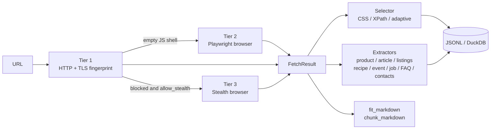

<div align="center">


# OmniScrape

**Adaptive web scraping for Python.** Tiered HTTP / browser / stealth fetching, self-healing selectors, zero-config product and article extraction, LLM-ready Markdown, a polite resumable crawler, a CLI and an MCP server, behind one small API.

[](https://pypi.org/project/omni-scraper/)
[](https://pypi.org/project/omni-scraper/)
[](https://github.com/loganathan-ai-dev/Omni-Scrape/actions/workflows/ci.yml)
[](https://github.com/loganathan-ai-dev/Omni-Scrape/blob/main/LICENSE)
[](https://github.com/astral-sh/ruff)
[](https://peps.python.org/pep-0561/)

[Install](#install) · [Quick start](#quick-start) · [Features](#features) · [Benchmarks](#benchmarks) · [Compare](#how-it-compares) · [Docs](#documentation) · [Contributing](#contributing)

</div>

```python
import omniscrape

page = omniscrape.scrape_sync("https://books.toscrape.com/catalogue/a-light-in-the-attic_1000/index.html")
page.product.title, page.product.price, page.product.currency   # ('A Light in the Attic', 51.77, 'GBP')
print(page.markdown)                                             # main content only, as clean Markdown
```

> [!NOTE]
> The PyPI package is named **`omni-scraper`** (the name `omniscrape` belongs to an unrelated project). You still `import omniscrape` and run the `omniscrape` command.

## Install

Requires Python 3.11+.

```bash
pip install omni-scraper
```

| Extra | Adds | Install |
|---|---|---|
| `browser` | Playwright Chromium rendering, actions, screenshots, PDF | `pip install "omni-scraper[browser]"` then `playwright install chromium` |
| `stealth` | Camoufox for opt-in stealth (`tier=3`) | `pip install "omni-scraper[stealth]"` |
| `fast` | Opt-in `selectolax` Lexbor CSS backend | `pip install "omni-scraper[fast]"` |
| `httpx` | Alternative HTTP/2 client (`tier="httpx"`) | `pip install "omni-scraper[httpx]"` |
| `storage` | DuckDB output | `pip install "omni-scraper[storage]"` |
| `markdown` | Exact token counts via `tiktoken` | `pip install "omni-scraper[markdown]"` |
| `mcp` | MCP server for AI agents | `pip install "omni-scraper[mcp]"` |
| `shell` | IPython for `omniscrape shell` | `pip install "omni-scraper[shell]"` |
| `all` | All of the above | `pip install "omni-scraper[all]"` |

## Features

| | |
|---|---|
| **3-tier fetching** | `curl_cffi` HTTP with a real browser's TLS fingerprint *and* matching headers (`tier=1`; Chrome, Edge, Safari, Firefox, Android, iOS profiles, rotation, HTTP/3), automatic escalation of empty JS shells to Playwright (`tier=2`), opt-in stealth browser (`tier=3`). |
| **Self-healing selectors** | Remembers 12 structural, context and content signals per element and relocates it after class renames, tag swaps, wrappers and attribute churn, rejecting ambiguous matches. |
| **Zero-config extraction for every page type** | Products, articles, listing cards, recipes, events, job postings, reviews and ratings, FAQs, organisation contacts, breadcrumbs, next-page links and data tables, from JSON-LD, Microdata, RDFa, OpenGraph and DOM fallbacks. No selectors needed. |
| **Page-type detection** | Every `scrape()` result says what the page is: product, article, recipe, event, job, listing, faq, organization or other. |
| **Declarative schemas** | `Selector.extract({...})` with price, date, unit and number normalizers. |
| **LLM-ready Markdown** | Main-content `fit_markdown`, BM25 query filtering, numbered citations, token-bounded `chunk_markdown`. |
| **Polite resumable crawler** | `robots.txt` on by default, `Crawl-delay`, AutoThrottle, `Retry-After` pauses, sitemap seeding, SQLite pause/resume, streaming, multi-session spiders (HTTP and browser pages in one crawl). |
| **CLI** | `get`, `crawl`, `map`, `extract`, `curl` (replay "Copy as cURL"), `shell`, `mcp`; output format from the file extension. |
| **MCP server** | FastMCP over stdio or streamable HTTP, eleven tools including page entities, schema extraction, listings, links, bounded crawls and screenshots. |
| **Agent skill and plugin** | Ready-made skill for Claude Code and other agents, plus a Claude Code plugin. |



## Quick start

<details open>
<summary><b>Single page and batch scraping</b></summary>

```python
import asyncio
import omniscrape

async def main():
    page = await omniscrape.scrape("https://quotes.toscrape.com/")
    print(page.title)           # page title
    print(page.markdown[:300])  # main-content Markdown, boilerplate removed
    print(page.links[:5])       # absolute links
    print(page.metadata)        # title, author, dates, site name, description, language

    pages = await omniscrape.scrape_many(
        ["https://quotes.toscrape.com/page/1/", "https://quotes.toscrape.com/page/2/"],
        concurrency=4,
        per_domain_concurrency=2,
    )

asyncio.run(main())
```
</details>

<details open>
<summary><b>Any kind of page: recipes, events, jobs, reviews, FAQ, contacts, pagination</b></summary>

```python
import omniscrape

page = omniscrape.scrape_sync("https://example.com/some-page")
page.content_type                      # 'recipe' | 'event' | 'job' | 'product' | 'article' | 'listing' | ...
ents = page.entities
ents.recipe.ingredients, ents.recipe.total_time_minutes
[(job.title, job.company, job.salary_min, job.remote) for job in ents.jobs]
[(e.title, e.start_date, e.location_name) for e in ents.events]
ents.rating, ents.rating_count, ents.reviews[:3]
[(q.question, q.answer) for q in ents.faq]
ents.organization.emails, ents.organization.phones, ents.organization.social_profiles
[c.name for c in ents.breadcrumbs], ents.next_page, ents.tables

# The same extractors work on HTML you already have:
from omniscrape import extract_entities, detect_content_type, find_next_page
extract_entities(html, url).jobs
```
</details>

<details>
<summary><b>Retries, proxies, caching, circuit breaker</b></summary>

```python
from omniscrape import OmniClient, ProxyPoolManager
from omniscrape.resilience import CircuitBreaker, DeadLetterQueue

async with OmniClient(
    retries=2,                        # transport errors, 429 (Retry-After) and 5xx
    timeout=30,
    cache_responses=True,             # ETag / Last-Modified conditional 304 caching
    headers={"Accept-Language": "en-GB"},
    proxy_pool=ProxyPoolManager(["http://user:pass@p1:8080", "http://p2:8080"], strategy="round_robin"),
    circuit_breaker=CircuitBreaker(failure_threshold=5, recovery_timeout=30),
    dead_letter=DeadLetterQueue("failed.db"),
) as client:
    res = await client.fetch("https://example.com/a")
    pages = await client.scrape_many(["https://example.com/b", "https://example.com/c"], concurrency=4)
```

Proxy strategies: `round_robin`, `random`, `sticky` (one proxy per domain). Register your own fetcher with `register_fetcher("my-api", MyApiFetcher)`.

Browser identity for the HTTP tier: every profile sends its own TLS fingerprint *and* headers, so they never contradict each other.

```python
await omniscrape.fetch(url, impersonate="safari")                  # one request as Safari
await omniscrape.fetch(url, http_version="3")                      # HTTP/3
OmniClient(fetcher_options={1: {"impersonate": ["chrome", "safari", "firefox"]}})   # rotate, one per host
OmniClient(fetcher_options={1: {"impersonate": ["chrome", "edge"], "rotate": "request"}})

# Replay a request copied from the browser's dev tools ("Copy as cURL"):
res = await omniscrape.fetch_curl("curl 'https://api.example.com/items?page=2' -H 'accept: application/json'")
```
</details>

<details>
<summary><b>Browser rendering and page actions</b></summary>

```python
res = await omniscrape.fetch(
    "https://example.com/products",
    tier=2,
    wait_for=".product-card",
    actions=[
        {"type": "click", "selector": "button.load-more"},
        {"type": "infinite_scroll", "max_scrolls": 5},
        {"type": "type", "selector": "input[name=q]", "text": "lamp"},
        {"type": "press", "key": "Enter"},
        {"type": "wait", "milliseconds": 500},
        {"type": "evaluate", "script": "() => document.querySelectorAll('.product-card').length"},
    ],
    screenshot=True,
    capture_network=True,
)
```

Actions: `click`, `type`/`write`/`fill`, `press`, `scroll` (`direction`, `amount`, or `to: "top"|"bottom"`), `infinite_scroll`, `wait` (`milliseconds`), `evaluate`, `screenshot`, `scrape`. Add `"optional": True` to continue if an action fails.
</details>

<details>
<summary><b>Selectors, schemas and self-healing</b></summary>

```python
from omniscrape import Selector

page = Selector(html, url="https://shop.example/list")
page.css("div.card h3::text").getall()
page.css("div.card a::attr(href)").get()
page.css("span.price").re(r"\$([\d.]+)")
page.xpath("//div[@data-sku='B2']/h3/text()").get()

item = page.extract({
    "title": "div.pdp h1::text",
    "price": {"selector": "div.pdp .price::text", "type": "price"},
    "tags": {"selector": "ul.tags li::text", "all": True},
})

# Self-healing: save a fingerprint once...
page = Selector(html_v1, url="https://shop.example/item/1", adaptive=True, storage="fingerprints.db")
page.css(".price-current", identifier="price", auto_save=True)

# ...and after a redesign the same call relocates the element.
page = Selector(html_v2, url="https://shop.example/item/1", adaptive=True, storage="fingerprints.db")
page.css(".price-current", identifier="price", adaptive=True)[0].text
```
</details>

<details>
<summary><b>Zero-config products, articles, listings and Markdown</b></summary>

```python
from omniscrape import extract_product, extract_listings, extract_metadata, fit_markdown, chunk_markdown

product = extract_product(html, url)              # JSON-LD, Microdata, RDFa, OG, Shopify JSON, DOM
listings = extract_listings(category_html, url)   # repeated cards on category / search pages
meta = extract_metadata(html, url)                # title, author, dates, tags
md = fit_markdown(html, url=url, query="pricing", links=True, citations=True, max_tokens=2000)
chunks = chunk_markdown(md, max_tokens=512)
```
</details>

<details>
<summary><b>Crawling with pause / resume</b></summary>

```python
import asyncio
from omniscrape import CrawlEngine, JSONLStorage, LinkExtractor, Request, Spider

links = LinkExtractor(same_domain=True)

class Books(Spider):
    name = "books"
    start_urls = ["https://books.toscrape.com/"]
    concurrency = 8

    async def parse(self, response, selector):
        if selector.css("div.product_main"):
            yield {"title": selector.css("h1::text").get(), "price": selector.css("p.price_color::text").get()}
        for url in links.extract(selector, response.url):
            yield Request(url, meta={"from": response.url})   # arrives as response.meta in the callback

stats = asyncio.run(CrawlEngine(
    Books(), storage=JSONLStorage("books.jsonl"), max_pages=200, queue_path="books-queue.db",
).run())
```

Multi-session spiders mix fetch configurations in one crawl, e.g. fast HTTP for category pages and a real browser for JavaScript product pages:

```python
class Shop(Spider):
    name = "shop"
    start_urls = ["https://shop.example/catalog"]
    sessions = {
        "http": {"tier": 1, "impersonate": "chrome"},
        "browser": {"tier": 2, "wait_for": ".price"},
    }
    default_session = "http"

    async def parse(self, response, selector):
        for href in selector.css("a.product::attr(href)").getall():
            yield Request(href, session="browser", callback=self.parse_product)
        if (nxt := omniscrape.find_next_page(response.html, response.url)):
            yield Request(nxt)

    async def parse_product(self, response, selector):
        yield omniscrape.build_scrape_result(response).product
```
</details>

### Command line

```bash
omniscrape get https://books.toscrape.com/                      # summary table
omniscrape get URL -f json > page.json                          # data on stdout, logs on stderr
omniscrape get URL -o page.md                                   # format from the extension: .json .md .html .txt
omniscrape get URL --css "h1::text" -H "Accept-Language: en" --proxy http://p:8080
omniscrape get URL --impersonate safari --http-version 3
omniscrape curl "curl 'https://api.example.com/x' -H 'accept: application/json'" -f json
omniscrape crawl https://books.toscrape.com/ --max-pages 100 -o books.jsonl --resume
omniscrape map https://example.com --search pricing
omniscrape extract URL --schema schema.json
omniscrape shell URL                                            # REPL with page, response, curl(), uncurl()
omniscrape mcp                                                  # stdio MCP server
omniscrape mcp --transport http --port 8000                     # streamable HTTP at /mcp
```

## Benchmarks

Reproducible, offline-first and honest about scope. Each tool runs in its own isolated virtual environment against the same corpus and a local test server. Ground truth comes from each page's own markup, never from another tool's output.

**Run:** `20261127-183312-release-0.1.0`, 2026-11-27, Windows 11, Intel 12-thread CPU, 11.7 GB RAM, Python 3.12 environments, 5 repeats. OmniScrape 0.1.0 (this release) against Scrapling 0.5.1 and Trafilatura 2.4.0. Raw numbers are committed in [`benchmarks/published/2026-11-27-release/`](https://github.com/loganathan-ai-dev/Omni-Scrape/tree/main/benchmarks/published/2026-11-27-release).

### At a glance

| Suite | Metric | OmniScrape | Scrapling 0.5.1 | Trafilatura 2.4.0 |
|---|---|---:|---:|---:|
| Self-healing selectors | Recovered, 1,377 broken cases | **100.0%** | 85.3% | n/a |
| Self-healing selectors | Wrong element picked | **0** | 202 | n/a |
| Self-healing selectors | Time per page | **31.0 ms** | 82.1 ms | n/a |
| Parsing, 143 pages × 5 | Pages per second | **474.6** | 338.1 | n/a |
| Crawl, 300 pages, concurrency 8 | Pages per second | **178.5** | 167.6 | n/a |
| JavaScript rendering, 60 pages | Pages per second | **10.2** | 5.5 | n/a |
| Live crawl, quotes.toscrape.com | Pages per second | 3.84 | 3.82 | n/a |
| Live crawl, books.toscrape.com | Pages per second | 5.18 | **5.29** | n/a |
| Main-content Markdown, 66 pages | F1 | **0.9903** | n/a | 0.9807 |
| Article extraction, 126 pages | F1 | **0.9418** | n/a | 0.9003 |
| Product extraction | F1 | **1.000** | n/a | not supported |
| Recipes, events, jobs, reviews, FAQ, contacts, page type | Zero-config | **yes** | not offered | not offered |

OmniScrape does not win every row. Scrapling was slightly faster on the books.toscrape.com live crawl and the quotes crawl is a tie; both live crawls are network-bound and only 20 and 40 pages long.

<details>
<summary><b>Self-healing selectors: recovery by mutation type</b></summary>

1,377 deliberately broken selectors across 60 pages (dev set 592, holdout 785).

| Tool | Recovered | Wrong element | Missed | ms per page variant | Peak RSS |
|---|---:|---:|---:|---:|---:|
| **OmniScrape** | **100.0%** (1,377) | **0** | 0 | **31.0** | 50.5 MB |
| Scrapling 0.5.1 | 85.3% (1,175) | 202 | 0 | 82.1 | 50.5 MB |

| Mutation | OmniScrape | Scrapling |
|---|---:|---:|
| All classes renamed | **100%** | 100% |
| Content changed | **100%** | 100% |
| IDs and `data-*` churned | **100%** | 96.5% |
| Look-alike siblings inserted | **100%** | 92.9% |
| Element wrapped | **100%** | 92.2% |
| Tag swapped | **100%** | 60.1% |
| Combined redesign | **100%** | 57.1% |

> [!NOTE]
> The mutations are generated by this repository's own script (`benchmarks/corpus/adaptive_cases.py`), so this is a self-benchmark: it shows how each tool copes with these classes of change, not an independent verdict. Run it yourself.
</details>

<details>
<summary><b>Parsing, crawling, rendering and startup</b></summary>

| Suite | Metric | OmniScrape | Scrapling 0.5.1 |
|---|---|---:|---:|
| Startup | Cold `import` time | **0.004 s** | 0.204 s |
| Startup | RSS after import | **26.6 MB** | 31.5 MB |
| Parse, 143 docs × 5 | Docs/s · MB/s · peak RSS | **474.6** · 13.0 · 52.2 MB | 338.1 · 9.3 · **46.4 MB** |
| Crawl, 300 pages, concurrency 8, robots on, 10 flaky 500s | Pages/s · peak RSS | **178.5** · **45.4 MB** | 167.6 · 59.5 MB |
| Live crawl, quotes (20 pages, concurrency 2) | Pages/s · peak RSS | 3.84 · **48.5 MB** | 3.82 · 62.4 MB |
| Live crawl, books (40 pages, concurrency 2) | Pages/s · peak RSS | 5.18 · **48.5 MB** | **5.29** · 62.4 MB |
| JS render, 60 pages, concurrency 4, shared context | Pages/s · peak RSS | **10.21** · 877 MB | 5.46 · 1,112 MB |
| JS render, isolated contexts | Pages/s · peak RSS | 10.06 · **594 MB** | n/a |

Crawl correctness for both tools: 321/321 allowed pages fetched, 0 `robots.txt` violations, 0 duplicate requests, 10/10 flaky HTTP 500s recovered. All 60 rendered pages succeeded for every tool. Crawl throughput over 3 runs: OmniScrape 178.5 pages/s (stdev 10.0), Scrapling 167.6 (stdev 5.1).
</details>

<details>
<summary><b>Markdown and zero-config extraction vs Trafilatura</b></summary>

| Suite | Metric | OmniScrape | Trafilatura 2.4.0 |
|---|---|---:|---:|
| Markdown, 66 pages | F1, overall | **0.9903** | 0.9807 |
| Markdown | F1, holdout | **0.9854** | 0.9811 |
| Markdown | F1, handwritten pages | **0.9838** | 0.9602 |
| Markdown | Boilerplate leakage, overall | **0.31%** | 0.96% |
| Markdown | ms per doc · peak RSS | **13.8 ms** · **51.7 MB** | 29.1 ms · 57.4 MB |
| Extract, 126 pages | Product F1 (all / holdout) | **1.000 / 1.000** | not supported |
| Extract | Article F1 (all / holdout) | **0.9418 / 0.8966** | 0.9003 / 0.8479 |
| Extract | ms per doc · peak RSS | **43.3 ms** · **57.6 MB** | 59.8 ms · 101.0 MB |

The extract timing includes everything `scrape()` now does per page: page-type detection and the recipe, event, job, review, FAQ, contact, breadcrumb, pagination and table extractors.
</details>

<details>
<summary><b>Methodology and reproducing</b></summary>

- One subprocess per (tool, suite); competitor tools live in separate environments built by `python -m benchmarks envs`.
- Crawl suite: a local server with 300 pages, 5-25 ms latency, a `robots.txt`, duplicate links and flaky pages. Coverage, duplicates and robots violations are counted **server-side**, not by the tool.
- The render suite reports OmniScrape's shared and isolated browser contexts separately.
- The run was made at commit `ef17721` with this release's changes applied but not yet committed (`git_dirty`).
- Browser and network suites vary between runs: the earlier run of the same day (also committed, in `benchmarks/published/2026-11-27/`) measured isolated rendering at 14.2 pages/s and the books live crawl at 4.46 (OmniScrape) vs 5.11 (Scrapling).
- Tools in the harness that are **not** in this published run: Crawl4AI, Scrapy, Crawlee, lxml, BeautifulSoup, selectolax, parsel, markdownify, html2text. They need `python -m benchmarks envs`; no numbers for them are claimed here.

```bash
git clone https://github.com/loganathan-ai-dev/Omni-Scrape.git && cd Omni-Scrape
pip install -e ".[dev,bench]"
python -m benchmarks envs                  # isolated environments per tool (needs uv)
python -m benchmarks run                   # all 7 suites, writes benchmarks/results/<run>/report.html
python -m benchmarks compare OLD_DIR NEW_DIR
```

See [`benchmarks/README.md`](https://github.com/loganathan-ai-dev/Omni-Scrape/blob/main/benchmarks/README.md).
</details>

## How it compares

Cells come from each project's own README or documentation, read on 2026-11-27. `—` means the page does not state it, which is not the same as "no". Corrections welcome via an issue.

| | **OmniScrape** | [Scrapling](https://github.com/D4Vinci/Scrapling) | [Crawl4AI](https://github.com/unclecode/crawl4ai) | [Scrapy](https://github.com/scrapy/scrapy) | [Crawlee (Python)](https://github.com/apify/crawlee-python) | [Trafilatura](https://github.com/adbar/trafilatura) |
|---|:---:|:---:|:---:|:---:|:---:|:---:|
| Async API | ✅ | ✅ | ✅ | engine only | ✅ | — |
| HTTP with TLS/browser impersonation | ✅ 6 browser families, rotation, HTTP/3 | ✅ incl. HTTP/3 | — | — | — | — |
| Real-browser rendering | ✅ | ✅ | ✅ | — | ✅ | — |
| Stealth / anti-bot fetcher | ◐ no challenge solving | ✅ claims Turnstile bypass | ✅ stealth mode | — | — | — |
| Adaptive / self-healing selectors | ✅ | ✅ | — | — | — | — |
| CSS and XPath | ✅ | ✅ | ✅ | ✅ | — | — |
| Spider with concurrency | ✅ | ✅ | ✅ deep crawl | ✅ | ✅ | ◐ |
| Pause / resume | ✅ | ✅ | ◐ crash recovery | — | ◐ persisted queue | — |
| `robots.txt` | ✅ on by default | ✅ opt-in | — | ✅ | — | — |
| Proxy rotation | ✅ | ✅ | ✅ | — | ✅ | — |
| CLI | ✅ | ✅ | ✅ | ✅ | scaffolding only | ✅ |
| Interactive shell | ✅ with curl import | ✅ | — | ✅ | — | — |
| MCP server | ✅ 11 tools | ✅ | ✅ | — | — | — |
| LLM-ready Markdown | ✅ | ✅ | ✅ | — | — | ✅ |
| Zero-config extraction: products, articles | ✅ | — | — | — | — | ✅ articles only |
| Zero-config extraction: recipes, events, jobs, reviews, FAQ, contacts, breadcrumbs, pagination | ✅ | — | — | — | — | — |
| Page-type detection | ✅ | — | — | — | — | — |
| Several fetcher types in one spider | ✅ named sessions | ✅ | — | — | — | — |
| Agent skill | ✅ | ✅ | — | — | — | — |
| License | MIT | BSD-3 | Apache-2.0 | BSD-3 | Apache-2.0 | Apache-2.0 |

**Where OmniScrape is behind today:** light browser stealth patches (no browser fingerprint randomisation) and no Cloudflare challenge solving, which this project deliberately does not build; no LLM-based extraction. Scrapling ships a more mature anti-bot story; if Turnstile bypass is your main need, use it.

## Documentation

- **Wiki:** [github.com/loganathan-ai-dev/Omni-Scrape/wiki](https://github.com/loganathan-ai-dev/Omni-Scrape/wiki)
- **Guides in the repo:** [docs/README.md](https://github.com/loganathan-ai-dev/Omni-Scrape/blob/main/docs/README.md): [fetching and stealth](https://github.com/loganathan-ai-dev/Omni-Scrape/blob/main/docs/fetching-and-stealth.md), [selectors and extraction](https://github.com/loganathan-ai-dev/Omni-Scrape/blob/main/docs/selectors-and-extraction.md), [crawling and storage](https://github.com/loganathan-ai-dev/Omni-Scrape/blob/main/docs/crawling-and-storage.md), [Markdown, CLI and agents](https://github.com/loganathan-ai-dev/Omni-Scrape/blob/main/docs/markdown-and-agents.md)
- **Agents:** the `omniscrape` skill ships in [`.claude/skills`](https://github.com/loganathan-ai-dev/Omni-Scrape/tree/main/.claude/skills/omniscrape) and [`.agents/skills`](https://github.com/loganathan-ai-dev/Omni-Scrape/tree/main/.agents/skills/omniscrape). As a Claude Code plugin: `/plugin marketplace add loganathan-ai-dev/Omni-Scrape` then `/plugin install omniscrape@omni-scraper`.

## Responsible use

> [!WARNING]
> OmniScrape detects anti-bot systems (Cloudflare, DataDome, PerimeterX, Akamai, Kasada, AWS WAF) and reports them in `defense_detected`. It does **not** solve CAPTCHAs or interactive challenges. The stealth tier runs only when you pass `allow_stealth=True` or `tier=3`. Only scrape what you are allowed to scrape.

- `CrawlEngine` and `map_site` obey `robots.txt`, including `Crawl-delay` and `*` / `$` wildcards, by default.
- `DomainThrottle` shares `Retry-After` cool-downs across workers. Respect site terms and prefer official APIs.
- See [SECURITY.md](https://github.com/loganathan-ai-dev/Omni-Scrape/blob/main/SECURITY.md) to report a vulnerability.

## Contributing

```bash
git clone https://github.com/loganathan-ai-dev/Omni-Scrape.git && cd Omni-Scrape
pip install -e ".[dev,browser,mcp,storage,fast]" && playwright install chromium
ruff check . && pytest
```

Read [CONTRIBUTING.md](https://github.com/loganathan-ai-dev/Omni-Scrape/blob/main/CONTRIBUTING.md). Release history is in the [CHANGELOG](https://github.com/loganathan-ai-dev/Omni-Scrape/blob/main/CHANGELOG.md).

## License

[MIT](https://github.com/loganathan-ai-dev/Omni-Scrape/blob/main/LICENSE) © 2026 Loganathan M
