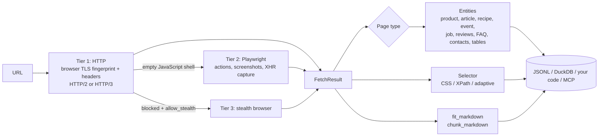

<p align="center">
  
</p>

<h1 align="center">OmniScrape</h1>

<p align="center">
  <b>Adaptive web scraping for Python: fetch anything, understand every page, survive redesigns.</b>
</p>

<p align="center">
  <a href="https://pypi.org/project/omni-scraper/"></a>
  <a href="https://pypi.org/project/omni-scraper/"></a>
  <a href="https://github.com/loganathan-ai-dev/Omni-Scrape/actions/workflows/ci.yml"></a>
  <a href="https://github.com/loganathan-ai-dev/Omni-Scrape/blob/main/LICENSE"></a>
</p>

<p align="center">
  <a href="#quick-start">Quick start</a> ·
  <a href="#choose-your-path">Choose your path</a> ·
  <a href="#what-omniscrape-understands">Page types</a> ·
  <a href="#architecture">Architecture</a> ·
  <a href="#production-checklist">Production checklist</a> ·
  <a href="#all-pages">All pages</a>
</p>

---

OmniScrape turns a URL into structured, trustworthy data with **no selectors to write**. It fetches with a real browser
identity (TLS fingerprint and headers that match, HTTP/3 when you want it), escalates to a real browser only when a page
needs JavaScript, tells you **what kind of page it is**, and extracts the data that page type carries: products,
articles, recipes, events, job postings, reviews, FAQs, contacts, breadcrumbs, pagination and tables. When you do write
selectors, they **heal themselves** after a site redesign.

```bash
pip install omni-scraper                 # the import and the command are both `omniscrape`
```

> [!NOTE]
> The PyPI name is `omni-scraper` (`omniscrape` belongs to an unrelated project). You still `import omniscrape` and
> run the `omniscrape` command. Optional extras such as `browser`, `mcp` and `storage` are listed on [[Installation]].

## At a glance

| | |
|---|---|
| **Selector healing** | 100% of 1,377 deliberately broken selectors recovered, 0 wrong elements (Scrapling 0.5.1: 85.3%, 202 wrong) |
| **Parsing speed** | 474.6 pages/s vs Scrapling's 338.1 on the same 143-page corpus |
| **Crawling** | 178.5 pages/s on a 300-page local site, 0 `robots.txt` violations, 0 duplicate requests |
| **Content quality** | Main-content Markdown F1 0.9903 (Trafilatura 0.9807); product extraction F1 1.000 |
| **Page types** | 9 page types detected; 11 kinds of data extracted without selectors (products and articles through FAQs, contacts and tables) |
| **Agents** | 11-tool MCP server, agent skill and Claude Code plugin |

Numbers come from the committed benchmark run of 2026-11-27; method, caveats and the rows OmniScrape does *not* win
are on [[Benchmarks]].

## Quick start

**Scrape any page and let OmniScrape work out what it is:**

```python
import omniscrape

page = omniscrape.scrape_sync("https://books.toscrape.com/catalogue/a-light-in-the-attic_1000/index.html")

page.content_type                    # 'product'
page.product.title, page.product.price, page.product.currency    # ('A Light in the Attic', 51.77, 'GBP')
[c.name for c in page.entities.breadcrumbs]                         # ['Home', 'Books', 'Poetry', 'A Light in the Attic']
page.markdown[:200]                  # main content only, boilerplate removed
```

**Use the extractors on HTML you already have** (no network):

```python
from omniscrape import extract_entities, detect_content_type, find_next_page

ents = extract_entities(html, url)
ents.recipe, ents.jobs, ents.events, ents.faq, ents.organization, ents.next_page
detect_content_type(html, url)       # 'recipe' | 'job' | 'listing' | ...
```

**Crawl politely, resumably, mixing HTTP and browser pages:**

```python
import asyncio

from omniscrape import CrawlEngine, JSONLStorage, Request, Spider, find_next_page, build_scrape_result

class Shop(Spider):
    name = "shop"
    start_urls = ["https://shop.example/catalog"]
    sessions = {"http": {"tier": 1, "impersonate": "chrome"}, "browser": {"tier": 2, "wait_for": ".price"}}
    default_session = "http"

    async def parse(self, response, selector):
        for href in selector.css("a.product::attr(href)").getall():
            yield Request(href, session="browser", callback=self.parse_product)
        if (nxt := find_next_page(response.html, response.url)):
            yield Request(nxt)

    async def parse_product(self, response, selector):
        yield build_scrape_result(response).product

# robots.txt is obeyed by default; queue_path makes the crawl resumable after a crash or Ctrl-C
asyncio.run(CrawlEngine(Shop(), storage=JSONLStorage("products.jsonl"), queue_path="shop.db").run())
```

**From the terminal:**

```bash
omniscrape get https://example.com/recipe -o recipe.json        # format follows the extension
omniscrape crawl https://books.toscrape.com/ --max-pages 100 -o books.jsonl --resume
omniscrape curl "curl 'https://api.example.com/items' -H 'accept: application/json'" -f json
omniscrape mcp                                                  # MCP server for Claude, Cursor and other agents
```

## Choose your path

| I want to... | Use | Read |
|---|---|---|
| Get structured data from one URL | `scrape()` / `omniscrape get` | [[Quick-Start]] |
| Know what a page is before parsing it | `page.content_type` / `detect_content_type()` | [[Selectors-and-Extraction]] |
| Extract recipes, jobs, events, reviews, FAQs, contacts | `page.entities` / `extract_entities()` | [[Selectors-and-Extraction]] |
| Pick exact fields myself | `Selector.css()` / `.xpath()` / `.extract(schema)` | [[Selectors-and-Extraction]] |
| Keep selectors working after a redesign | `Selector(..., adaptive=True)` | [[Selectors-and-Extraction]] |
| Render JavaScript, click, scroll, screenshot | `fetch(url, tier=2, actions=[...])` | [[Fetching-and-Stealth]] |
| Look like Safari, Firefox or a phone; use HTTP/3 | `fetch(url, impersonate="safari", http_version="3")` | [[Fetching-and-Stealth]] |
| Replay a request from the browser's dev tools | `fetch_curl()` / `omniscrape curl` | [[Fetching-and-Stealth]] |
| Crawl a whole site, pause and resume | `Spider` + `CrawlEngine(queue_path=...)` | [[Crawling-and-Storage]] |
| Feed pages to an LLM or a RAG index | `fit_markdown()` / `chunk_markdown()` | [[Markdown-and-Agents]] |
| Give an AI agent web access | `omniscrape mcp` | [[MCP-Server]] |
| Script it from a shell | `omniscrape` commands | [[CLI-Reference]] |

## What OmniScrape understands

Every `scrape()` result carries a `content_type` and an `entities` object. Structured data (JSON-LD, Microdata, RDFa,
OpenGraph) is read first; DOM fallbacks cover pages without it.

| Page type | What you get | Without markup? |
|---|---|---|
| `product` | title, price, currency, brand, SKU, availability, rating, images | yes: DOM heuristics, embedded Shopify JSON |
| `article` | title, author, dates, body text, tags, reading time | yes: main-content scoring |
| `listing` | cards with title, URL, price, image; next page | yes: repeated-card detection, pager detection |
| `recipe` | ingredients, steps, prep/cook/total minutes, servings, calories, rating | schema.org Recipe |
| `event` | dates, status, attendance mode, venue and address, organiser, price, tickets | schema.org Event |
| `job` | company, location, remote, employment type, salary range and period | schema.org JobPosting |
| `faq` | question and answer pairs | yes: `<details><summary>` accordions |
| `organization` | name, logo, emails, phones, address, social profiles | yes: `mailto:`/`tel:` links and visible emails |
| any page | reviews and aggregate rating, breadcrumbs, next-page URL, data tables | breadcrumbs, pagination and tables: yes |

Product and article fields are only reported where they belong: a news article does not get a "product", and a
category page does not get one card's price as its product.

## Architecture



- **Fetching** is tiered: cheap HTTP first, a real browser only when the page is an empty JavaScript shell, and a stealth
  browser only when you allow it. Retries, `Retry-After`, a circuit breaker, proxy rotation and a dead-letter queue sit
  around every tier.
- **Understanding** happens once per page: one parse feeds page-type detection, every extractor, the selectors and the
  Markdown converter.
- **Delivery** is your choice: Python objects, JSONL or DuckDB files, the CLI, or an MCP server for agents.

## Production checklist

- [ ] **Reuse a client** for many URLs: `async with OmniClient(...)`, or `fetch_many` / `scrape_many` with per-domain
      concurrency. One-off `scrape()` calls open and close a session each time.
- [ ] **Be polite**: `robots.txt` (with `*`/`$` wildcards and `Crawl-delay`) is on by default; keep it on unless you own
      the site. Set `download_delay` or `autothrottle=True` for busy sites.
- [ ] **Make long crawls resumable** with `queue_path=` (or `omniscrape crawl --resume`).
- [ ] **Check the page type** before trusting fields: `page.content_type`.
- [ ] **Handle blocks explicitly**: blocked responses carry `defense_detected`; nothing silently passes a challenge page
      off as content.
- [ ] **Keep stdout for data**: logs go to stderr, so `omniscrape get URL -f json | jq` and the MCP stdio transport stay clean.
- [ ] **Pin the version** in production: `omni-scraper==0.1.0`. Python 3.11 to 3.13; HTTP/3 needs `curl_cffi>=0.15`
      (installed by default).

## Limits and responsible use

> [!WARNING]
> OmniScrape detects anti-bot systems (Cloudflare, DataDome, PerimeterX, Akamai, Kasada, AWS WAF) and reports them. It
> does **not** solve CAPTCHAs or bypass challenges, and its stealth tier only runs when you opt in. Scrape only what you
> are allowed to scrape, respect rate limits and terms, and prefer official APIs where they exist.

Known gaps, stated plainly: no browser fingerprint randomisation, no LLM-based extraction, and page-type detection is a
heuristic (141 of 143 labelled benchmark pages correct). See [[Comparison]] for how this stacks up against other tools.

## All pages

| Page | What it covers |
|---|---|
| [[Installation]] | `pip install`, optional extras, Playwright, installing from source |
| [[Quick-Start]] | Scrape a page, batch scrape, extract fields, crawl a site |
| [[Fetching-and-Stealth]] | Fetcher tiers, browser identities and HTTP/3, retries, proxies, browser actions, curl replay, custom fetchers |
| [[Selectors-and-Extraction]] | CSS/XPath, schemas, self-healing selectors, page types and zero-config entities |
| [[Crawling-and-Storage]] | `Spider`, `CrawlEngine`, multi-session spiders, politeness, pause/resume, JSONL and DuckDB |
| [[Markdown-and-Agents]] | `fit_markdown`, chunking, CLI and MCP overview, agent skills and the Claude Code plugin |
| [[CLI-Reference]] | Every `omniscrape` command and flag, including `curl` |
| [[MCP-Server]] | The eleven MCP tools, transports, Claude Code and Claude Desktop setup |
| [[Benchmarks]] | Published results against Scrapling and Trafilatura, methodology, how to reproduce |
| [[Comparison]] | Feature comparison with Scrapling, Crawl4AI, Scrapy, Crawlee and Trafilatura |
| [[FAQ-and-Troubleshooting]] | Common problems and fixes |
| [[Contributing]] | Dev setup and contribution guidelines |

<p align="center"><sub>MIT licensed · <a href="https://github.com/loganathan-ai-dev/Omni-Scrape">Source</a> · <a href="https://pypi.org/project/omni-scraper/">PyPI</a> · <a href="https://github.com/loganathan-ai-dev/Omni-Scrape/issues">Issues</a></sub></p>
